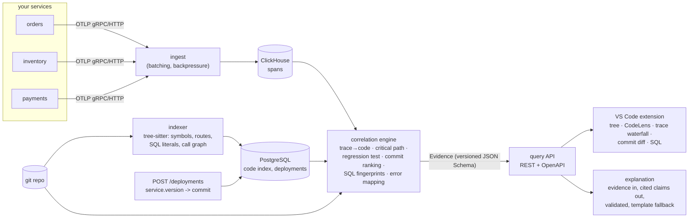

# TraceLens

**"Something is slow in production. Show me exactly where it comes from in my code, what changed, and the evidence."**

TraceLens joins OpenTelemetry traces, a code index, git history and deployment records, and answers
in VS Code: *this endpoint regressed on deploy 1.3.0; the time went into `findOrdersByUser` at
`orders.ts:28`; the query `select … where user_id = ?` got 8x slower and PostgreSQL now plans a
sequential scan; commit `14f06cf` dropped `orders_user_id_idx`; here are the traces and numbers.*
The core is a deterministic correlation engine. An LLM may phrase the result, but every claim it
makes must cite evidence IDs and is validated, and the product is fully useful with the LLM off.



## Quickstart (about 1 minute to a running stack, about 4 more for the guided demo)

Needs Docker (with compose v2) and `make`. For the extension also Node 20 and VS Code.

```bash
git clone <this repo> tracelens && cd tracelens
docker compose up -d --build        # ClickHouse, PostgreSQL, ingest, API, 3 demo services, load generator
curl 'localhost:18080/endpoints?service=orders&window=5m'      # traces are flowing: endpoints with p50/p95
```

Then, to see a diagnosis (deploys four versions of the demo, one of which drops an index and one of
which throws, runs TraceLens on each pair and checks the verdicts; measured at about 4 minutes):

```bash
scripts/demo.sh
```

and in VS Code open **Run and Debug → "TraceLens extension (demo)"** (F5), or let
`scripts/walkthrough.sh` drive the whole chain in a real VS Code and assert it. In the extension:
the **TraceLens** view lists the regressions, each with the function, the slow query (and its plan),
the ranked commits with reasons, and a trace; click a commit for its diff, a query for its SQL, a
function for the code; **CodeLens** above functions shows `p95 46ms ↑102% since v1.2.0`.

## 2-minute demo (script for a screen recording)

| Time | Show | Say |
|---|---|---|
| 0:00 | `docker compose up -d`, then `curl …/endpoints` | "One command brings up ingestion, storage, the API and a demo app under load. Traces are already flowing." |
| 0:20 | VS Code, TraceLens view, deployment 1.2.0 → 1.3.0 | "Version 1.3.0 shipped. TraceLens flags one endpoint: `GET /users/:userId/orders`, p95 up 73%. The other endpoints are quiet, and it says why: they serve as controls." |
| 0:40 | Expand the regression; click the function, then the slow query | "The time moved into `findOrdersByUser`. The query is slower per call, not called more often, and EXPLAIN shows a sequential scan of `orders.orders`." |
| 1:05 | Click commit `#1 Drop unused orders user_id index` → diff | "The ranked suspect has no application code in it: a migration dropped the index. Every other commit in the range scores zero." |
| 1:25 | Click the trace; scroll the evidence panel; click a citation | "Here is the waterfall with the critical path, and the evidence behind each claim. The explanation cites evidence IDs; each citation jumps to the item. With the LLM off you get the same structure from a deterministic template." |
| 1:45 | Switch to 1.3.0 → 1.4.0: the error group → opens `orders.ts:54` | "A different deploy: a new exception, mapped through the source map to the exact throwing line, and the commit that added it." |
| 1:55 | CodeLens `p95 … ↑% since v…` above a function | "And the numbers follow you into the editor." |

## What is here

| Path | What |
|---|---|
| `ingest/` | OTLP/gRPC + HTTP receiver, batching, backpressure, ClickHouse writer (Python) |
| `indexer/` | tree-sitter indexer for TypeScript/JavaScript: symbols, Express/Fastify routes, SQL literals, call graph, incremental per commit |
| `engine/` | the correlation engine: trace→code mapping, critical path, regression detection, commit ranking, SQL fingerprints, errors, Evidence |
| `api/` | REST API (OpenAPI in `api/openapi.json`): deployments, comparisons, symbols, traces, queries, commits, explanations |
| `explainer/` | evidence-in, cited-claims-out explanation layer with a validator and a template fallback |
| `extension/` | VS Code extension (TypeScript, pure core + thin glue) |
| `demo/` | three-service Node/TypeScript app, load generator, scripted bad deployments |
| `schema/` | the Evidence JSON Schema, source of truth for Python and TypeScript types |
| `bench/`, `scripts/` | benchmarks, end-to-end acceptance runs, walkthrough |
| `docs/` | `DESIGN.md` (design doc), `DECISIONS.md` (30 ADRs), `BENCHMARKS.md`, `EVAL.md` |

## Develop and test

```bash
make check                 # ruff, mypy --strict, unit tests of every Python package (Docker only)
make gen-check             # generated Evidence types are current
cd extension && npm ci && npm test            # unit + contract tests;  npm run test:vscode  runs tests inside VS Code
scripts/e2e_phase5.sh      # deploy bad versions, assert endpoint, query, plan, commit and file:line (~10 min)
make eval-template         # explanation evaluation without a model
```

## Status and honest limits

Python rather than Go (ADR-0004); TypeScript/JavaScript is the only indexed language; one repository
per API process; no authentication (non-goal for the MVP). Measured numbers, with hardware and
caveats, are in [`docs/BENCHMARKS.md`](docs/BENCHMARKS.md). The explanation layer's live-model
evaluation has not been run (it needs an API key: `ANTHROPIC_API_KEY=… make eval-llm`); what was measured
and what was not is in [`docs/EVAL.md`](docs/EVAL.md). Open questions and known gaps are listed in
[`docs/DESIGN.md`](docs/DESIGN.md).
